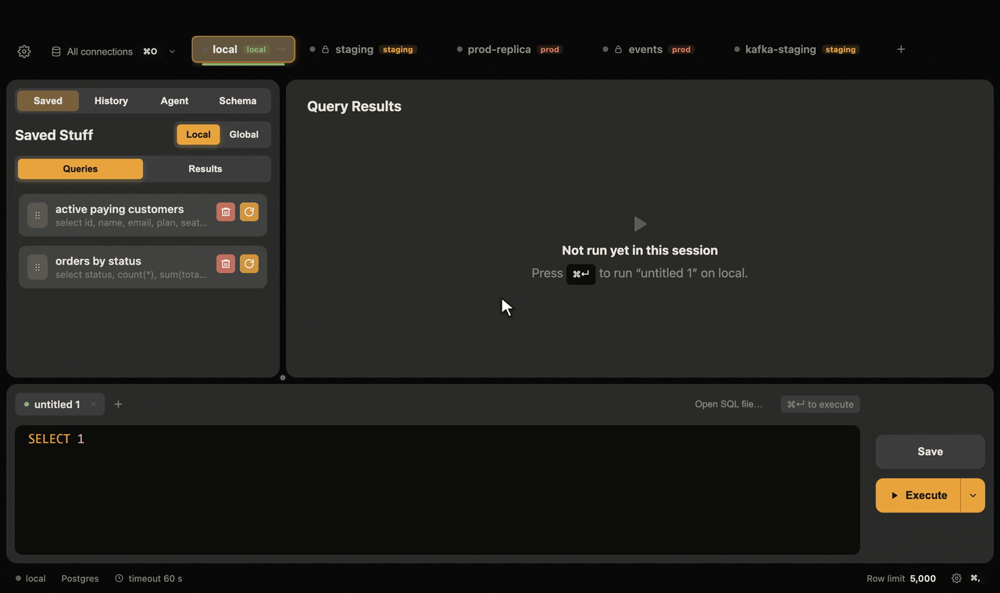
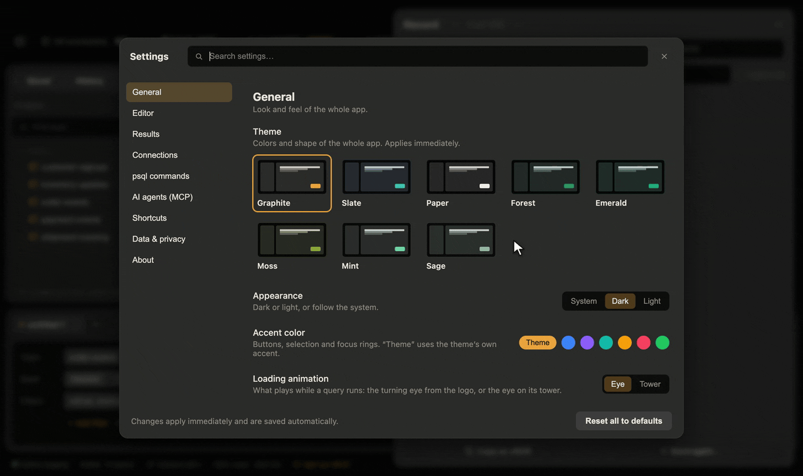
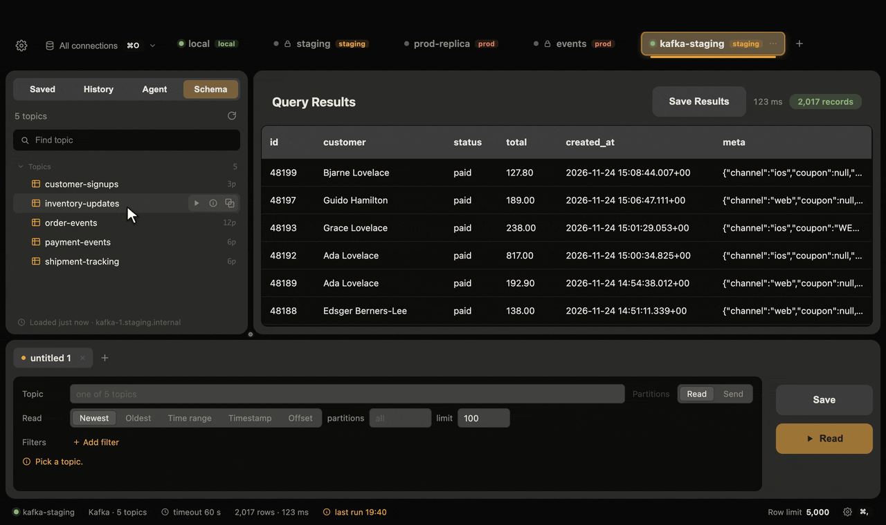

<p align="center">
  
</p>

# Sauron

A desktop app (macOS, Windows, Linux) for looking into **Postgres**, **ClickHouse** and **Kafka**: run queries, read topics and see
the results in a readable form. AI agents can use the same saved connections through its built-in MCP server.



## Install

Download the build for your platform from [Releases](https://github.com/Svovoniks/sauron/releases). The app checks for updates at launch
and asks before installing one.

- **macOS:** drag the app to Applications. Releases are not notarized, so the first start needs System Settings → Privacy & Security →
  **Open Anyway**. If macOS says the app is "damaged", run `xattr -cr /Applications/sauron.app` once
- **Windows** may show a SmartScreen warning for the same reason

## Features

- **Editor:** completion for tables and columns (aliases too), query tabs that run at the same time, scripts with a result tab per
  statement, `.sql` files, history and saved queries
- **Results:** formatted JSON, a record view with a collapsible JSON tree, search, and a row cap (5,000 by default, "Load more" fetches the rest)
- **Errors** underline the failing statement and suggest fixes, such as "did you mean ...?" for a mistyped column
- **Schema** sidebar with tables, views, functions, columns and keys
- **psql commands:** text starting with `\` goes to your `psql`; without it, the read-only catalog commands (`\dt`, `\d table`, ...) still work
- **Postgres clusters:** several hosts per connection with a primary / replica choice, TLS and client certificate login
- **Safe by default:** connections are read-only with a query timeout until you change that, and a connection tagged prod asks you to
  type its name before any write
- **Themes:** eight colour themes, each with a dark and a light variant



### Shortcuts

`Cmd` on macOS, `Ctrl` elsewhere. Every shortcut can be changed in Settings.

| Action                                     | Keys                          |
|--------------------------------------------|-------------------------------|
| Run (statement at cursor or whole script)  | `Cmd+Enter`                   |
| Run everything / explain                   | `Cmd+Shift+Enter` / `Cmd+Alt+Enter` |
| Cancel the running query                   | `Cmd+.`                       |
| Command palette                            | `Cmd+K`                       |
| New tab / close tab                        | `Cmd+T` / `Cmd+Shift+W`       |
| Switch connection                          | `Cmd+O`, `Cmd+1..9`           |
| Search in results                          | `Cmd+F`                       |
| Move through results                       | `j` / `k` or arrow keys       |
| Settings                                   | `Cmd+,`                       |

## Kafka



- connect with a broker address and an optional login (SASL SCRAM-SHA-512, SCRAM-SHA-256 or PLAIN); TLS is not supported yet
- **Read** the newest or oldest messages, a time range, from a timestamp or from an offset, and filter on the key, the value, a JSON
  field (`value.status`) or a header
- reading never joins a consumer group or commits offsets, so real consumers are not affected
- **Send** a message with headers, picking the partition by key (FNV-1a or murmur2) or by number

## AI agents (MCP)

Agents such as Claude Code, Codex or Cursor start the app's executable with `--mcp`; the app does not have to be running.
Settings → AI agents copies the setup command, for example:

```sh
claude mcp add sauron -- /Applications/sauron.app/Contents/MacOS/sauron --mcp
```

- tools: `list_connections`, `list_tables`, `describe_table`, `query`, and `read_messages` / `send_message` for Kafka
- agents pick connections by name and never see a password; a connection's description tells them what the database is for
- **read-only** unless you add `--allow-writes`, and connections that are read-only or tagged prod stay read-only even then
- the **Agent** tab in the sidebar shows every call an agent made and what it got back

## Your data

Connections, saved queries, history and settings are JSON files in the app data folder (macOS:
`~/Library/Application Support/com.svovoniks.sauron/`). Passwords are kept apart from them: in the Windows Credential Manager, the
Secret Service on Linux, and an encrypted file on macOS. Export can include passwords only in plain text, and asks first.

## Known issues

- **psql commands are not sandboxed:** `\! cmd`, `\i file` and `\copy ... program` run on your machine. Do not run backslash commands
  from saved queries or exports you did not write
- "read-only" uses the database's own read-only mode, which a script can switch off; for real protection use a role that can only SELECT
- a script stops at its first failing statement

## Development

```sh
bun install
make run      # the app (bun run tauri dev)
make check    # type check, unit tests, clippy
bun run dev   # the UI in a browser with a fake backend; add ?demo to the URL for realistic data
```

- the Rust integration tests are skipped unless `SAURON_TEST_PG_PORT` (Postgres with a table
  `t(id bigint, name text, flag bool, arr int[], j jsonb)` holding 2500 rows) or `SAURON_TEST_CH_PORT` (ClickHouse, see
  `src-tauri/src/clickhouse.rs`) is set
- `demo/record/record.sh` re-records the GIFs above (needs `brew install ffmpeg gifski`); the steps are in `demo/record/scenes.ts`
- **releases:** bump the version in `package.json` and `src-tauri/Cargo.toml`, then push a tag `app-v<version>`. CI publishes the
  release once every platform has uploaded. It needs these GitHub Actions secrets:
  - `TAURI_SIGNING_PRIVATE_KEY` and `TAURI_SIGNING_PRIVATE_KEY_PASSWORD` sign the updates. The public key is in
    `src-tauri/tauri.conf.json`; make a new pair with `bunx tauri signer generate -w ~/.tauri/sauron-updater.key`
  - `MACOS_CODESIGN_P12` and `MACOS_CODESIGN_P12_PASSWORD` hold the self-signed macOS certificate. Keep the same certificate forever:
    a new one makes macOS treat the app as a different one
